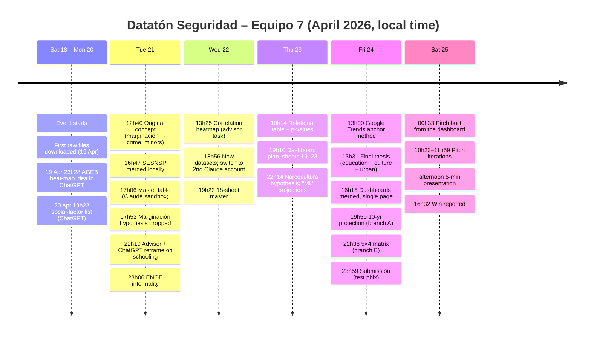

# 04 · Project evolution, turning points and decisions

All times are **Hermosillo local time (UTC−7)**, converted from the UTC timestamps in the Claude exports or
taken from file modification times. The full machine-readable timeline is
[`../recovery/master_timeline.csv`](../recovery/master_timeline.csv) (36 events, each with precision and confidence).
Conversation shorthand: **CL1** = Claude account A main chat, **CL2** = Claude account B main chat (see
`recovery/conversation_catalog.csv`).

## Timeline at a glance

## Phases

| # | Phase | When | Evidence |
|---|---|---|---|
| 0 | Exploration in ChatGPT (AGEB heat map, factor list, advisor's first task) | 19 Apr 23:28 – 21 Apr 12:36 | GPT-B `69e5c778`, `69e6df0e` |
| 1 | Idea and problem framing | 21 Apr 12:40–14:15 | CL1 msgs 0–7 |
| 2 | Data acquisition and SESNSP merge | 19–21 Apr | file dates; CL1 msgs 8–21 |
| 3 | First integration (master table, correlations) | 21 Apr 17:06–17:47 | CL1 msgs 22–33, CL1-C025/C035 |
| 4 | **Collapse of the original hypothesis** | 21 Apr 17:52 | CL1 msgs 34–35 |
| 5 | Re-framing with the advisor | 21 Apr 22:10–22:15 | CL1 msgs 38–41 |
| 6 | Enrichment (ENOE, ACLED, CONEVAL, IRS, housing) | 21 Apr 23:06 – 22 Apr 19:23 | CL1 47, CL2 0–7 |
| 7 | Relational table and full correlation analysis | 23 Apr 10:14 | CL2 msg 9 |
| 8 | Dashboard construction | 23 Apr 19:10 – 25 Apr 01:22 | CL2 10–63; .pbix / PDF files |
| 9 | Narcocultura hypothesis and Google Trends | 23 Apr 22:14 – 24 Apr 23:38 | CL2 12–14; CL1 56–59; CL2 48–63 |
| 10 | Projections ("ML") | 23 Apr 22:36; 24 Apr 19:50 | CL2 15–17; CL1 66–67 |
| 11 | Submission | 24 Apr 23:59 | e-mail screenshot |
| 12 | Pitch writing | 25 Apr 00:17–11:59 | CL2 64–65; GPT-A `69ec6e24`, `69ec71c3`, `69ec79d1`; CL1 68–83 |
| 13 | Presentation and result | 25 Apr, before 13:01 (presentation); win known by 16:32 | GPT-A `69ec79d1` msgs 12–16; CL2 66–69 [REPORTED] |
| 14 | Post-competition | 26 Apr – Jun 2026 | CL1 84–89; CL2 70–133 |

## Major turning points

**TP1 — The marginación hypothesis fails (21 Apr 17:52)** [VERIFIED]. After adding absolute counts of
15–17-year-olds out of school, the top-10 list was simply the largest cities. The team wrote *"no shit
sherlock, hermosillo es la ciudad más poblada… una parte de nuestra narrativa original no entra, que es que a
mayor marginalidad más delitos"* (CL1 msg 34). Claude's per-capita check showed Guaymas, a low-marginación
municipality, with the highest rate of detained minors per 1,000 youths (2.81). **Consequence:** marginación
stopped being the protagonist and became the "myth" the story would refute.

**TP2 — Advisor reframing (21 Apr 22:10)** [VERIFIED, CL1 msgs 38–41]. The advisor and a ChatGPT reading of the
correlation matrix led to the slogan *"si pisas una escuela, es menos probable que cometas un delito"*.
An early ChatGPT summary of the matrix called the education links "positive". ChatGPT later corrected that: the education-deficit coefficients are negative. The final argument rests on youth **out of school**, not on those coefficients [VERIFIED, GPT-A `69e82fc2`]. The
advisor then widenedThe
advisor then widened the question to *why people in Sonora fall into crime*, beyond minors only. Claude
warned in the same exchange that the municipal data could not support an individual-level claim (ecological fallacy).

**TP3 — Switch to a second AI account (22 Apr 18:56)** [VERIFIED/INFERENCE]. The account-A chat stopped
mid-answer (CL1 msg 53). The team uploaded a text copy of the conversation to account B (*"lo tiene el otro
claudio"*, CL2 msg 4). From then on two chats ran in parallel and produced **two branches** of the master
workbook. This explains `sonora_maestro_v5.xlsx` (account A, 10-year projection) versus
`v5(1)` → `v6` (account B, 5×4 matrix + Google Trends artists).

**TP4 — The narco-culture hypothesis and projections (23 Apr 22:14–22:36)** [VERIFIED, CL2 msgs 12–14].
SESNSP showed narcomenudeo almost doubling while total crime stayed flat, and ITAMA showed most interned minors held
for drug offences. The team proposed that the popularity of narco-culture is part of the same picture. They added
trend projections to show where narcomenudeo is heading: linear projections first, a 10-year scenario the next day.

**TP5 — Final thesis (24 Apr 13:31)** [VERIFIED, CL1 msg 60]: *"la combinación educación + contexto cultural +
marginación (puede o no) en un contexto urbano es lo que lleva la subida de crímenes."*

**TP6 — From dashboard to story (25 Apr 00:17–11:59)** [VERIFIED, CL2 msg 64; GPT-A; CL1 68–83]. With the dashboard
submitted and no time left to add a formal Google Trends correlation chart, the team built the pitch from what the
dashboard shows: narcomenudeo and narco-artist interest rising side by side, framed as *"No estamos diciendo que cause
el delito. Pero sí que coexiste con él."* The jury responded most to exactly that link.

## Decision history (summary; detail in `recovery/decision_history.md`)

| ID | Date | Decision | Previous → new | Reason given | Implemented |
|---|---|---|---|---|---|
| D01 | 21 Apr | Analyse marginación → crime, minors focus | — | official question + available data | yes, then revised |
| D02 | 21 Apr | Rebuild indicators from primary sources (ITER) instead of PDF | PDF tables → Census microdata | rigour, municipal granularity | yes |
| D03 | 21 Apr | Merge SESNSP yearly CSVs with a local script | 11 files → 1 | Claude upload convenience | yes |
| D04 | 21 Apr | Build all tables in Claude's sandbox; Excel with gov palette for Power BI | — | speed | yes |
| D05 | 21 Apr | Add 15–17 non-attendance (pct and absolute) | 12–14 only → 15–17 | team: most detained minors are 15–17 | yes |
| D06 | 21 Apr | Drop "más marginación → más delito" as thesis | marginación-centred → education-centred | absolute counts track population; weak r | yes |
| D07 | 21 Apr | Slogan "si pisas una escuela…" | — | advisor + ChatGPT | yes (pitch) |
| D08 | 21 Apr | Broaden to why people in Sonora fall into crime | minors only → general | advisor | partially |
| D09 | 21 Apr | Add ENOE informality (state level only) | — | advisor's dataset list | yes (not in final dashboard) |
| D10 | 22 Apr | Heatmap + crime-type trends for Power BI | — | advisor tasks | yes |
| D11 | 22 Apr | Add ACLED, CONEVAL, IRS, housing; reject migration (not found) and drug-use survey (too old) | — | coverage | yes |
| D12 | 23 Apr | Relational table + p-values | r only → r + p | rigour | yes |
| D14 | 23 Apr | Narcocultura hypothesis; projections for the jury | — | jury appeal (explicit) | yes |
| D17 | 24 Apr | Google Trends anchor rescaling; drop 14 noisy terms | raw blocks → rescaled | ChatGPT critique | yes |
| D19 | 24 Apr | One long-scroll dashboard page; merge aesthetic + useful dashboards | 4-page prototype → 1 page | storytelling | yes |
| D20 | 24 Apr | 10-year polynomial projection | 3-yr OLS → 10-yr poly | advisor | branch A only, not in final dashboard |
| D21 | 24 Apr | Reduced 5×4 correlation matrix | 13×13 → 5×4 | readability | yes (final dashboard) |
| D23 | 25 Apr | Pitch only what the dashboard shows; "nada de inferencias" | — | time; honesty request | partially (see 10_limitations) |
