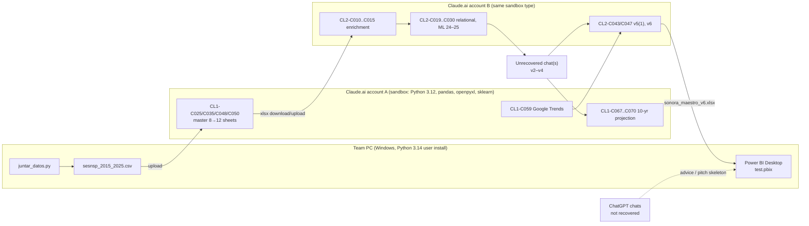

# 07 · Software architecture

## Actual historical system (April 2026)



- **Languages:** Python (pandas, numpy, openpyxl, scipy, scikit-learn, matplotlib/seaborn installed but not used for deliverables), DAX in Power BI, bash wrappers in the sandbox.
- **Entry points:** none in the usual sense. Every step was a `python3 << 'EOF' … EOF` block that Claude ran in response to a chat message. Files moved between steps by manual download and upload; filenames gained suffixes like `(1)` and `_2_` along the way.
- **External services:** Claude.ai (two accounts), ChatGPT, Google Trends web UI, Power BI Desktop.
- **Configuration / environment variables:** none.
- **State:** the Excel workbooks themselves. Later steps re-read earlier outputs.

## Source code catalog

| Artifact | Origin | Status | Location |
|---|---|---|---|
| `juntar_datos.py` (team's local version) | team PC, 21 Apr | historical, executed; hard-coded paths | `src/legacy/juntar_datos_ORIGINAL_local.py` (paths redacted) |
| `juntar_datos` (Claude's last proposed version) | CL1 msg 19 | historical; differs from local (team added latin-1 fallback, header fix) | `src/legacy/juntar_datos_CL1-C019_claude_version.py` |
| `pipeline_seguridad_sonora.py` | CL1 msg 1 (`create_file`) | written, **never executed** (first draft before data was seen) | `src/historical/CL1-C002_*.py` |
| 25 sandbox scripts (stages A1–C, branch A, analyses) | CL1/CL2 | executed in sandbox; 17 re-run in recovery | `src/historical/*.sh` |
| 148 code fragments in total (incl. failed attempts, DAX, LaTeX) | both exports | catalogued | `recovery/recovered_code_catalog.csv` |
| `reproduce.py`, `verify.py`, `merge_sesnsp.py`, `audit_checks.py` | **RECONSTRUCTED** in 2026-11 recovery | tested | `src/` |

Classification: *production-quality:* none. *Exploratory/experimental:* all historical sandbox scripts.
*Abandoned:* `CL1-C002` (first draft), failed runs (e.g. `CL1-C022`, `CL1-C024`, `CL1-C043..C047`, `CL1-C062`, `CL1-C064`, `CL1-C067..C069`).
*Unverified:* branch A projection code (`CL1-C070` does not reproduce v5).

## Version history of key artifacts

See [`../recovery/version_history.md`](../recovery/version_history.md). In short:
`sonora_seguridad_powerbi(1)` (8 sheets) → 12 → 18 → `v2` (22) → `cons` (restart) → `(3)` (28) → `v3` (30) → `v4` (31)
→ { `v5` (34, branch A) | `v5(1)` (33) → **`v6` (36, canonical)** }.

## Technical debt (historical)

1. Name-based joins between sources with different spellings and encodings (largest defect, see `10_limitations.md`).
2. ITER census read as latin-1 although it is UTF-8 → 20 mojibake municipality names.
3. Sheets with decorative title rows (double/triple headers) that later broke Power BI and the scripts themselves (CL1 msgs 62–65).
4. Excel 31-character sheet-name limit hit (`12_Correlaciones_Heatmap_PowerBI` truncated).
5. No version control; versions distinguished by download suffixes; two parallel AI branches.
6. Hard-coded absolute paths in the only local script.
7. Silent `fillna(0)` after left joins turns "no match" into "zero crime".

## Proposed architecture (for a future, corrected version — not implemented)

```
src/dataton_sonora/
  ingest/      one loader per source, explicit encodings, schema checks
  keys.py      INEGI cve_mun (5-digit) as the only join key; name→code crosswalk incl. "Obregón"→Cajeme
  build.py     master table with per-capita and per-youth rates, single-year denominators
  analysis/    correlations with p-values + Spearman + partial correlations controlling for population; FDR correction
  forecast/    Poisson/negative-binomial time series with prediction intervals, monthly data, hold-out validation
  export.py    flat (single-header) tables for Power BI
tests/         fixtures per source; join-coverage assertions (no silent losses)
```

The current repository deliberately keeps the **historical** pipeline intact (replayed by `src/reproduce.py`),
so the competition results can be audited exactly as they were produced.
