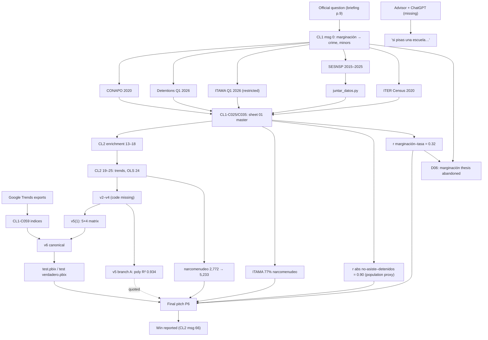

# Project knowledge graph

Conversation → code → data → result → dashboard → pitch. Tabular form: [`cross_source_index.csv`](cross_source_index.csv); claim-level evidence: [`evidence_traceability.csv`](evidence_traceability.csv).

